# PettyCash

PettyCash is an Android app for managing petty cash floats: request cash, approve and pay out via M-Pesa, record spends with receipts, claim refunds, reconcile month-end cash counts, and keep a full audit trail. Built from the PettyCash KE v2 Figma design system ("MAI").

## Screenshots

<table>
  <tr>
    <td>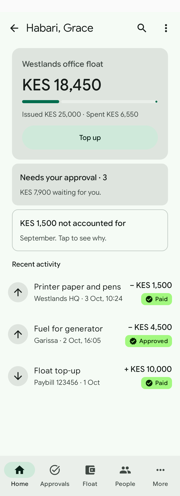<br/><sub>Admin home</sub></td>
    <td>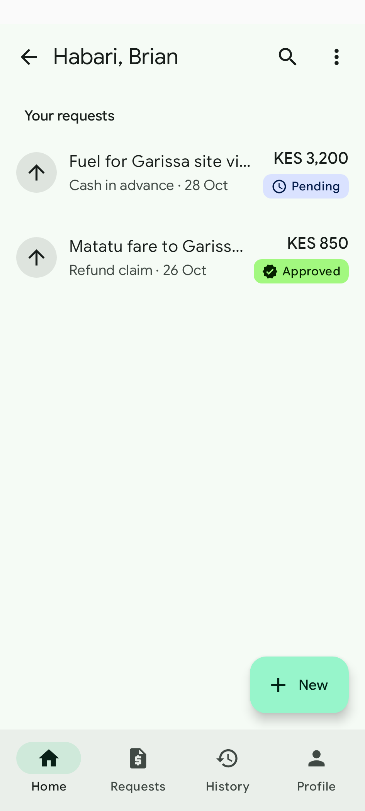<br/><sub>Member home</sub></td>
    <td>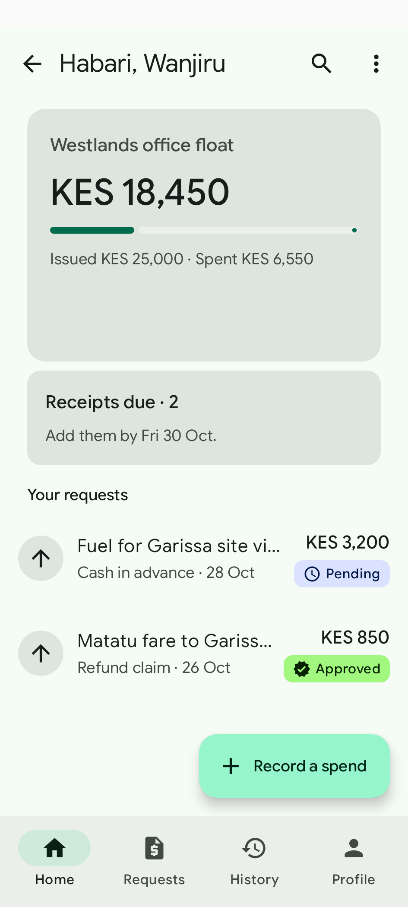<br/><sub>Custodian home</sub></td>
  </tr>
  <tr>
    <td>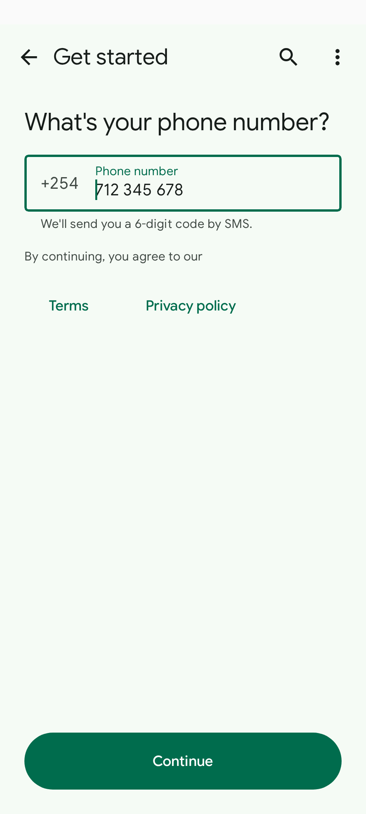<br/><sub>Sign in</sub></td>
    <td>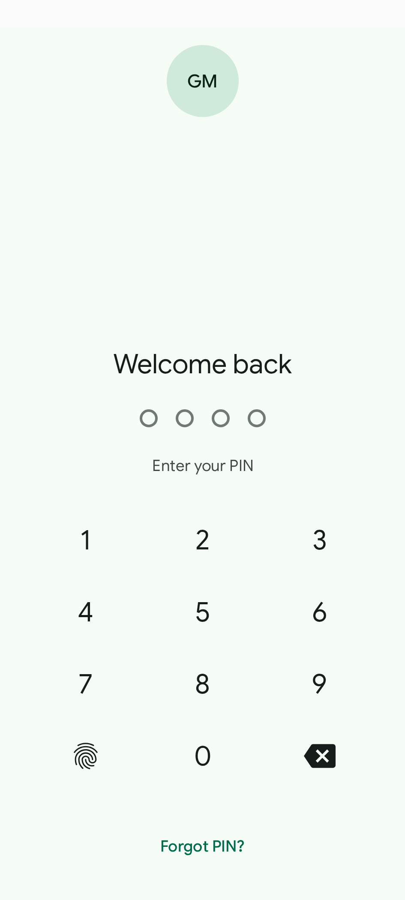<br/><sub>PIN unlock</sub></td>
    <td>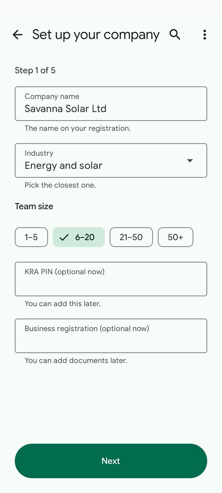<br/><sub>Company onboarding</sub></td>
  </tr>
  <tr>
    <td>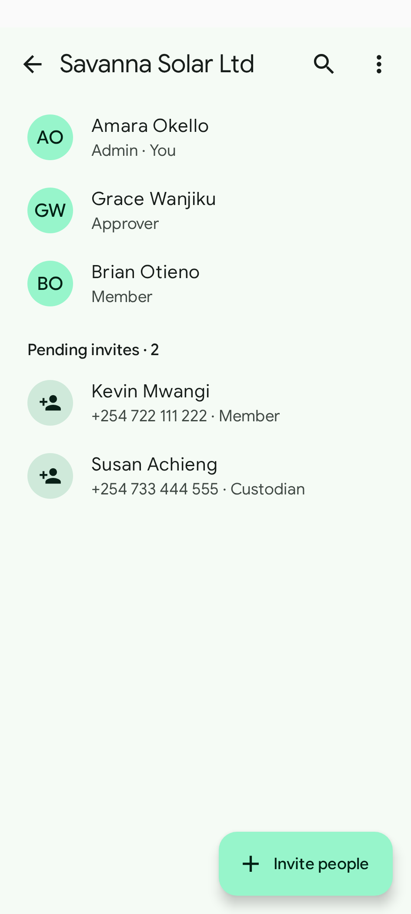<br/><sub>Team &amp; invites</sub></td>
    <td>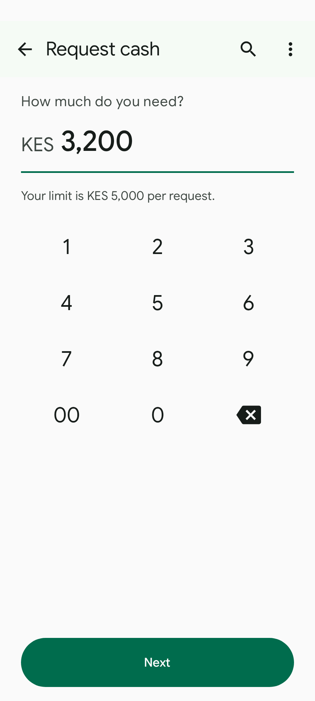<br/><sub>Request cash</sub></td>
    <td>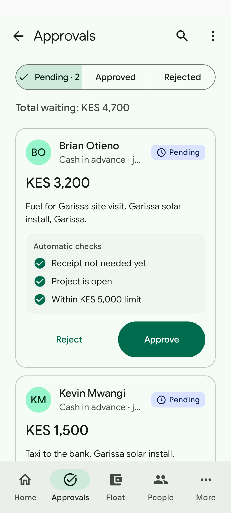<br/><sub>Approvals</sub></td>
  </tr>
  <tr>
    <td>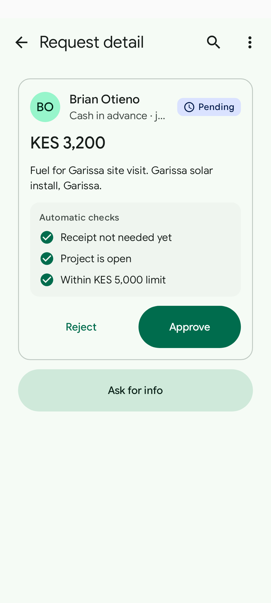<br/><sub>Approval detail &amp; payout</sub></td>
    <td>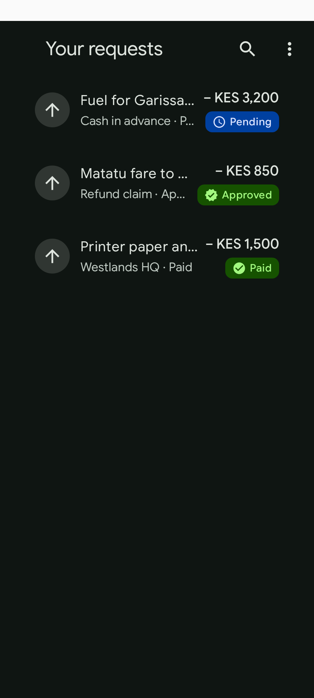<br/><sub>Member requests (dark)</sub></td>
    <td>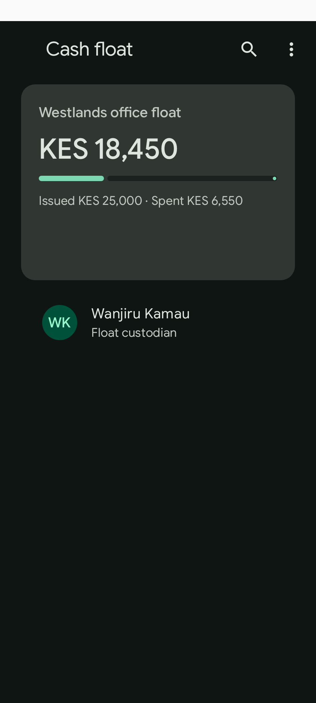<br/><sub>Floats (dark)</sub></td>
  </tr>
  <tr>
    <td>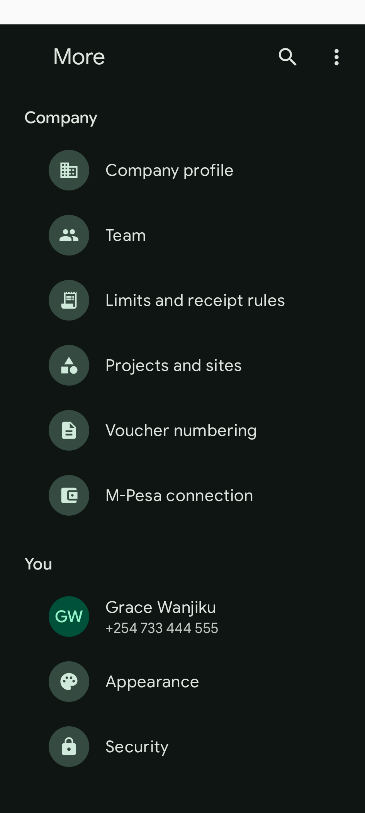<br/><sub>Settings (dark)</sub></td>
    <td></td>
    <td></td>
  </tr>
</table>

## What it does

- **Onboarding & auth** — splash, intro pager, phone + SMS verification (simulated), PIN create/confirm, fingerprint offer, unlock, new-device flow
- **Company setup** — 5-step onboarding: company details, M-Pesa connect (simulated), first float, approval rules, projects/sites/vouchers, team invites
- **Homes per role** — Admin, Custodian and Member dashboards with role switcher, setup checklist, approval/unaccounted/receipt cards, recent activity, and a "New" action sheet
- **Request cash** — amount keypad with limit enforcement, details, review, sent with voucher code, request detail with timeline
- **Approve & pay** — approvals list with filters and totals, request detail, ask-for-info and reject sheets with undo, payout review, duplicate warning, PIN confirmation, simulated M-Pesa payout
- **Record a spend** — stepped one-screen flow: amount, line items, category/project/site, M-Pesa code matching, receipt camera page, review
- **Claim a refund** — amount, details, photo/no-receipt proof, refund destination, review
- **Floats & top-ups** — float list, float detail with month's spending, top-up keypad flow
- **Month-end reconciliation** — count reminder, cash count with notes-and-coins helper, result with variance, explain-the-gap, admin review, month closed
- **Records** — unified activity history with search and filters, notifications, expense detail, audit trail, voucher preview
- **Settings** — profile, admin "More" hub, appearance (theme/high contrast), security (PIN change, fingerprint, phones), company forms for limits/projects/vouchers/M-Pesa
- **Invite & join** — team list, invite people, invite preview with error states, join details, data consent, how-it-works pager

All data is stored locally (DataStore); M-Pesa and SMS flows are simulated. A Ktor remote layer is scaffolded for a future backend.

## Architecture

Multi-module Gradle project following a feature-first structure:

```
app/                  Application, MainActivity, Navigation 3 root, Koin app module
core/
  designsystem/       MAI design system — components, theme, typography, motion
  presentation/       MviViewModel base, Navigator, LocalNavigator
  datasource/local/   DataStore preferences (auth, company, invites, activity, settings)
  datasource/remote/  Reserved Ktor HTTP layer (not yet wired)
features/<name>/
  api/                NavKey definitions + public contracts
  impl/               data layer, ViewModels (MVI), Compose screens, Koin module
```

### Patterns

- **Navigation 3** — serializable `NavKey` routes, `koinEntryProvider()`, `LocalNavigator` for cross-feature navigation
- **MVI** — shared `MviViewModel<Action, Event, State>` with `StateFlow` state and one-time `Channel` events, `CollectOneTimeEvent` in UI
- **DI** — Koin; each feature exposes a `navigation<Key> { }` block in its impl module
- **Stepped flows** — multi-step flows (spend, refund, request, onboarding) are a single `NavKey` + single screen; only content animates between steps, camera pages may replace the screen
- **Route → Screen → Content** composable split with `collectAsStateWithLifecycle`

## Technologies

- Kotlin, Jetpack Compose (Material 3), Navigation 3
- Koin (core, android, compose, navigation3)
- DataStore Preferences for local persistence
- kotlinx.serialization for stored JSON models
- Custom design system "MAI" built on Material 3 color roles + custom type scale
- Gradle convention plugins (`build-logic`) for android library, feature api/impl modules
- Testing: JUnit + Robolectric ViewModel tests, Compose screenshot tests (`screenshotTest` source set with goldens), instrumentation test setup

## Build & test

```bash
./gradlew assembleDebug          # build the app
./gradlew testDebugUnitTest      # unit + ViewModel tests
./gradlew updateDebugScreenshotTestDefaultTestSuite   # regenerate screenshot goldens
./gradlew testDebugScreenshotTestDefaultTestSuite     # verify screenshots
```

## Accessibility

Implemented per the design file's per-screen notes: 48dp minimum targets, tab position announcements ("Approvals, tab 2 of 5"), one-item spoken descriptions for cards and rows, custom Approve/Reject actions, heading semantics, live regions for banners/amounts, selected/toggleable states on chips, switches, radios and segmented controls, and dark-mode + edge-to-edge system bar handling.
